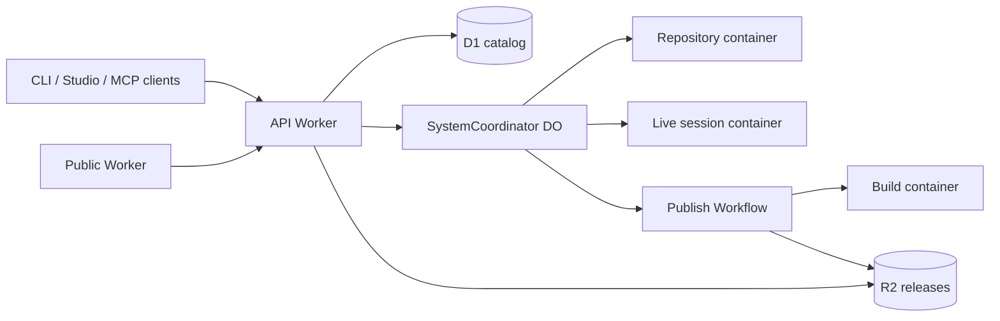

# TimDS Host

**GitHub for design systems.** Self-host it on Cloudflare.

[](LICENSE)
[](https://github.com/sticktrk/timds-host/actions/workflows/foundation.yml)
[](.nvmrc)

TimDS Host gives a design system the things source code has had for years: a
repository, branches of work, reviewable previews, versioned releases with
rollback, and a published read endpoint that any consumer (a site, an app, an
AI agent) can trust. It runs entirely on Cloudflare Workers, Containers, D1, R2,
Queues and Workflows. There is no server to run.

The design-system toolkit itself is the separate Apache-2.0 package
[`@dtconcepts/timds`](https://www.npmjs.com/package/@dtconcepts/timds). This
repository is the host that toolkit talks to.

## What you get

- **Sessions and change sets.** Every piece of work on a design system happens in
  a session with its own live preview, backed by a real Git repository in a
  Cloudflare Container.
- **Requests to a designer agent.** Humans steer; an agent does the editing.
  Requests run in native live sessions and come back as reviewable submissions.
- **Previews.** Each submission is frozen and deployed as its own Worker, so
  reviewers look at a real URL instead of a screenshot.
- **Publication with rollback.** A seven-stage Workflow builds, verifies and
  copies releases into an object-locked R2 bucket. Releases are immutable; the
  published pointer can move back to any earlier version.
- **Public reads and MCP.** A separate public Worker serves the published
  system at `/systems/<org>/<name>/`, every release immutably at
  `/v/<label>/`, and `/v/latest/` as a redirecting tag for the current
  pointer. A read-only MCP endpoint at `/mcp` on the same origin lets AI
  tools read the current release with an exact source and version receipt,
  and the toolkit's `timds mcp read --published <root>` serves the full
  consumer tool set from those files.
  [Consuming a published system](docs/consuming/README.md) is the guide set
  for people and agents building from one.
- **Studio.** A static steering console for sessions, Requests, Previews,
  publish and rollback. It is served straight from the host and has no build
  step.
- **Real identity.** Cloudflare Access for people, OAuth for CLI and MCP
  clients, and per-source grants checked in D1 on every mutation.

## Deploy on Cloudflare

You need a Cloudflare account, Node.js 22.18 or newer, and a local Docker
engine that can build Linux AMD64 images (the three container images build on
your machine and run on Cloudflare). Python 3 runs the deploy helper.

The deployment identity needs Workers, Containers, D1, R2, KV, Queues and
Workflows in the account. The full procedure, with every setting explained, is
the [operations runbook](docs/operations.md). The short version:

**1. Install and sign in.**

```bash
git clone https://github.com/sticktrk/timds-host.git && cd timds-host
```

```bash
npm ci && npm --prefix public-worker ci
```

```bash
npx cf auth login
```

**2. Describe your installation.** Copy the example environment file and fill
in the required values. The file is gitignored and must stay owner-only.

```bash
cp .env.example .env && chmod 600 .env
```

The minimum is your account id, a Worker name such as `timds-example`, the two
origins the Worker and its public companion will answer on, and the Artifacts
namespace map. Leave the Access settings empty for now. The runtime secrets at
the bottom of the file (a registered Workers Builds token, an OpenAI API key
for the designer agent, and a fresh random bootstrap secret) are required
before step 3.

**3. Create resources and deploy.** The helper reads `.env`, creates the queue,
D1 catalog and snapshot and release buckets, applies the catalog migration,
locks the releases bucket as immutable, and deploys both Workers. Created
resource ids are kept in a gitignored state file beside `.env`. The media
bucket is created once by hand.

```bash
python3 scripts/deploy-host.py resources
```

```bash
npx cf r2 buckets create --name timds-example-media
```

```bash
python3 scripts/deploy-host.py catalog
```

```bash
python3 scripts/deploy-host.py lock
```

```bash
python3 scripts/deploy-host.py deploy
```

`deploy` deploys the API host and then the public companion. To redeploy the
companion on its own:

```bash
python3 scripts/deploy-host.py public
```

Your host answers at `https://timds-example.<subdomain>.workers.dev/health` as
soon as the deploy finishes.

**4. Let people sign in.** Create a Cloudflare Access application for the three
paths `/authorize`, `/bootstrap` and `/service-auth` on the host origin (the
runbook has a script that emits the application plan). Put its team domain and
audience into `.env` and run the deploy step again. Then sign in with the
pinned toolkit and claim the administrator seat:

```bash
node node_modules/@dtconcepts/timds/bin/timds.mjs auth login --portal-url https://timds-example.example.workers.dev --oauth
```

```bash
node scripts/admin.mjs bootstrap --host https://timds-example.example.workers.dev --operation-id <uuid> --secret-file /private/path/bootstrap-secret
```

**5. Create your first design system.** Create an organization and a designer
agent with `scripts/admin.mjs`, put the agent's principal id into `.env`, redeploy,
then provision a source from a fresh toolkit seed. The runbook's
["Organization, designer and fresh system"](docs/operations.md#organization-designer-and-fresh-system)
section walks through it, and the [conformance package](conformance/README.md)
can exercise the finished host against a disposable source.

Open `https://timds-example.example.workers.dev/studio` to see Studio.

### What gets created

| Resource | Purpose |
| --- | --- |
| Worker `<name>` | The API: OAuth, API v1, Studio assets, event feed, MCP |
| Worker `<name>-public` | Public reads only. It holds no secrets and one service binding |
| D1 `<name>-catalog` | Principals, organizations, sources, grants, audit |
| Durable Objects | One SQLite coordinator per design system; the publication pointer lives here |
| R2 `<name>-snapshots`, `<name>-releases`, `<name>-media` | Source and build snapshots, object-locked releases, source media |
| Queue `<name>-events` | Repository events pushed to coordinators |
| Containers | Repository sandbox, live session, and ephemeral build sandbox |
| Workflow | The seven-stage publication pipeline |

Redeploy with the same `.env` and the deploy step. Cloudflare Access
invitations, portal imports, custom Studio domains and legacy public hostnames
are optional and documented in [`docs/`](docs/README.md).

## Local development

| Command | Does |
| --- | --- |
| `npm run typecheck` | Generates Worker types, then `tsc --noEmit` |
| `npm run build` | Bundles the Worker and builds the three container images (needs Docker) |
| `npm test` | Fast smoke suite: modules load, migrations apply, Access tokens verify, public serving and MCP answer |
| `npm run check:docs` | Markdown links resolve and every document is indexed |
| `npm run check:boundary` | Scans added lines for installation records and credentials |
| `npm run check` | All of the above except `build` |
| `npm run dev` | `cf dev`. Artifacts has no local emulator, so it still needs a disposable remote namespace |

None of the checks need Cloudflare credentials. Local checks prove the code
compiles and the in-process paths hold; they do not prove a deployed host
behaves. [`docs/ci.md`](docs/ci.md) and
[`docs/verification.md`](docs/verification.md) separate the two.

## How it fits together



The API Worker authenticates every request, resolves the source, and hands it
to that source's coordinator. Request bodies never choose a source or an actor.
Every mutation rechecks current authority in D1 at the moment it runs. API v1
is additive only and vendored as an
[OpenAPI 3.1 contract](docs/api/timds-host.openapi.json); clients send
`X-TimDS-API-Version: 1`.

The [architecture document](docs/architecture.md) covers the request path,
SQLite and D1 invariants, publication stages, OAuth and Access policy, public
serving and Studio in depth.

## Documentation

- [`docs/README.md`](docs/README.md) indexes every document by the question it answers.
- [`docs/operations.md`](docs/operations.md) is the deployment and operations runbook.
- [`docs/architecture.md`](docs/architecture.md) is the design.
- [`docs/api/timds-host.openapi.json`](docs/api/timds-host.openapi.json) is the API contract.
- [`conformance/README.md`](conformance/README.md) is the live API conformance harness.
- [`studio/README.md`](studio/README.md), [`src/requests/README.md`](src/requests/README.md)
  and [`src/preview/README.md`](src/preview/README.md) sit next to the code they specify.

## Contributing

[`AGENTS.md`](AGENTS.md) is the contract for any change: the repository map,
which checks apply to which kind of change, code conventions, and the public
boundary. Two rules matter most:

- **Keep installation records out of the repository.** No customer names,
  domains, account or source ids, release hashes or operational receipts in
  code, docs, commits or pull requests. Use synthetic names and reserved
  example domains. `npm run check:boundary` enforces this on every branch.
- **Documents are the specification.** A runtime change is not finished until
  the document that describes that area agrees with the code.

Run `npm run check` before opening a pull request, and say in the description
which checks ran and whether deployed acceptance is still owed.
[`.github/PULL_REQUEST_TEMPLATE.md`](.github/PULL_REQUEST_TEMPLATE.md) lists
the questions a reviewer will ask.

## License

Apache License 2.0. See [LICENSE](LICENSE) and [NOTICE](NOTICE). Third-party
dependencies keep their own licenses. The toolkit,
[`@dtconcepts/timds`](https://www.npmjs.com/package/@dtconcepts/timds), is
also Apache-2.0.
