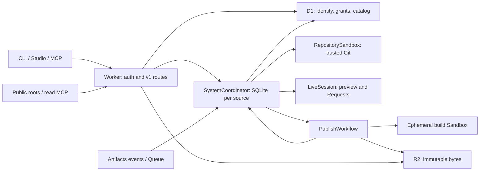

# Host architecture and migration plan

The isolated host now implements the coordinator/store, native repository and
live containers, offline publication builds, seven-stage Workflow, OAuth/Access,
public roots/MCP and Studio described here. The deployed resource and HTTP
receipts are in deployment evidence (private operational record). Authenticated
host authoring and publication acceptance, phone usage and production migration
remain in progress. The health endpoint deliberately reports integration status.

The design was reviewed against portal commit `2b0148c` and toolkit OAuth
[PR #100](https://github.com/sticktrk/timds-toolkit/pull/100). The
production portal baseline passed (private operational record), and
the subsequent Request recovery and fixture cleanup are settled in that receipt.
The original proposed interfaces below remain design context; concrete modules
under `src/` and `runtime/` are authoritative for implemented names. Migration
and portal-client sections describe work still required before cutover.

The detailed store review (private operational record) records the exact
adapter methods and constraints; the runtime extraction plan (private operational record)
records the latest Request recovery, binary transport and native refresh
behavior that must survive the port. The OAuth client branch now includes
upstream toolkit `0.1.470`; conformance and controlled publication remain pinned
to the issue's `0.1.464` baseline.

## Ownership and request path

The Worker authenticates and validates an API v1 request, resolves its source,
and calls the source's `SystemCoordinator`. The coordinator owns collaboration
state and the publication pointer. Repository operations run in the trusted
`RepositorySandbox`; editable previews and model processes run in `LiveSession`.
`PublishWorkflow` drives durable publication receipts. D1 owns identity,
system access and publisher grants, and provides catalog and audit queries.
R2 stores immutable source/build snapshots, releases and media.



Source UUID, immutable `systemId`, principal UUID and operation UUID remain
distinct. Name a coordinator from the source UUID, with its organization and
immutable identity verified at initialization. Never route by a caller-supplied
repository name. HTTP callers cannot supply a trusted actor object: the Worker
constructs it after OAuth or Access verification, and the coordinator checks
the current D1 authority before protected effects.

The existing OpenAPI file has 20 paths and 22 operations. Keep the v1 version
header, envelopes, status codes, source/system lookup rules, change-set CAS and
`{path,key?,base,mine,theirs}` conflicts. Some paths accept a source UUID or
system ID; Requests require a source UUID. UUID-only session, submission,
publication and Request routes need a D1 `resource_index(kind,id,source_id)`.
This is a locator, never an authorization decision. Confirm source binding in
the DO; preserve tombstones so IDs cannot be reassigned. Publish a new locator
before returning its resource to the client. Interrupted index writes recover
from the DO outbox; do not scan every coordinator as a fallback.

## Reuse and module boundaries

Paths in this table retain the original portal baseline and proposed extraction
map. Actual implemented destinations sometimes use different names. Keep the existing snake_case persistence rows behind the
store adapter initially, and the existing camelCase wire views at the boundary.

| Existing boundary | Planned destination and adaptation |
| --- | --- |
| `server/design-system-sessions.mjs` | `src/domain/sessions.mjs`: reuse validation, views and session/draft/claim/member operations with injected store, repository and authorization. Replace the Node router with Fetch routing. |
| `server/design-system-collaboration-store.mjs` | `src/store/sqlite.ts`: implement its JSON-row interface; do not copy the Supabase query adapter. |
| `server/design-system-publication-steps.mjs` | `src/domain/publication.mjs`: retain explicit receipts and identity checks; split existing `release` into release and flip. |
| `server/design-system-submission-publish.mjs`, `design-system-rollback.mjs` | Coordinator admission/queue/rollback methods; remove execution-job and Supabase ownership. |
| `server/design-system-repository-rpc.mjs` | `src/repository/control.ts`: retain prepare/complete/release capability checks with DO rows and Artifacts bindings. |
| `cloudflare/timds-designer/{repository-service,repository-engine,repository-daemon,live-session,policy,callback}.mjs` and Dockerfiles | Preserve repository and live-session RPC contracts and trust separation. Native Sandbox adaptation follows the proven spike. |
| `server/design-system-authorization.mjs` | `src/auth/*`: replace Supabase profiles/principals/grants with verified OAuth/Access identity and D1 policy. |
| `server/design-system-designer-requests.mjs` | `src/domain/requests.ts`: replace observations/execution jobs with durable Request receipts while preserving v1 responses. |
| `server/design-system-submission-publish-worker.mjs` | `src/build/*` plus an image-baked adapter. Its filesystem, subprocess and Docker code cannot execute in a Worker. |
| `server/design-system-publication-artifacts.mjs` | `src/artifacts/staging.ts`: R2 write-once staging with the same opaque-reference checks. |
| `server/design-system-public-roots.mjs`, `design-system-read-mcp.mjs` | `src/public/*`, `src/mcp/*`: preserve byte selection and views; replace local-filesystem/Supabase access with R2 and catalog adapters. |
| `server/design-system-public-urls.mjs` | Inject a configured URL builder; preserve imported configured domain aliases and slug mappings. |

The session factory already accepts
`createDesignSystemSessions({store,repository,authorization,cleanupAgentSession,onSessionReserved,onSessionStarted,now})`.
The optional legacy `getSupabaseAdmin` default must not be reached in the host.
Its methods cover start, snapshot, submit, update, status, history, close, join,
claim, active work, drafts, token preview and cleanup. The store's `eligible`
currently joins portal Clients, Projects and repos. Replace that policy with
host organization/source lifecycle checks; do not invent portal records.
Its optional heartbeat enables a Node timer; omit that adapter method and
use bounded lease receipts plus alarms and explicit progress checkpoints.

Proposed store construction, for review before implementation:

```ts
createSqliteCollaborationStore({
  sourceId,
  storage: ctx.storage, // SQL and synchronous local transactions
  catalog,             // typed D1 source/identity reads; no query builder escapes
  authority,           // coordinator-owned serialized grant/fence protocol
  clock,
  ids,
});
```

Proposed binding-only coordinator surface:

| Method | Purpose |
| --- | --- |
| `execute({sourceId,operation,actor,input})` | Exhaustive allowlist of v1 session, draft, Request, publish and rollback operations; no arbitrary method invocation. |
| `mutateGrant({operationId,actor,expectedVersion,mutation})` | The only path for system access or publisher-grant changes. |
| `publicationStep({publicationId,attempt,step,receipt})` | Workflow admission, checkpoint and flip; validates queue head, immutable identity and execution fence. |
| `repositoryControl({operationId,coordinatorId,method,args,phase})` | Existing prepare/complete/release protocol; validates stored source/session/submission identity and capability lifetime. |
| `designerCallback({requestId,sessionId,event,receipt})` | Authenticated, idempotent callback bound to the stored Request and runner. |
| `artifactsEvent({eventId,repositoryId,ref,revision})` | Deduplicated push/build facts; never accepts author identity from the event. |
| `fencePrincipal({operationId,principalId,version})` | Durable acknowledgement for global deactivation. |
| `migration({operationId,phase,manifest})` | Administrative import/freeze/activate protocol with authority epoch and checksums. |
| `alarm()` | Expiry, pending-operation recovery, outbox delivery and remote cleanup. |

These are internal proposals, not additional public v1 endpoints. Require
trusted bindings or separately authenticated control routes. Restrict each
caller to its operation family; a Workflow receipt is not a general author
credential. Public route registration must not expose control methods.

## SQLite schema and invariants

Use one SQLite-backed DO per source. Run ordered additive migrations during
initialization and record their version. Schema migration may briefly block
initialization; do not hold `blockConcurrencyWhile` across Git, D1, build or
other long network work. The proposed tables are:

| Table | Key state and constraints |
| --- | --- |
| `source_state` | Single source identity; lifecycle; authority epoch; current version/digest/commit; monotonic pointer generation and next queue sequence. |
| `sessions` | UUID, source, owner, kind/name, base/head revisions, status, expiry, operation lease/generation, fork identity, originating Request. Unique owner/idempotency key locally, backed by a global D1 reservation; draft names remain unique while starting/open/closing. |
| `members` | Unique `(session_id,principal_id)` and role. Membership does not replace active principal/source access. |
| `claims` | Unique `(session_id,principal_id,kind)`, bounded path/key payload and expiry. Expired claims never block a write. |
| `submissions` | UUID, session/source, request hash, immutable base/head, diff/note, review branch/preview status, integration/publication state. Unique session/request hash. |
| `publications` | UUID, unique submission, queue sequence, stored actor/note, stage/status, attempt fence, immutable source/build/stamp receipts, result and pointer event. |
| `requests` | Stable Request UUID, requester/source/prompt, logical execution UUID, session/submission, runner state, callback deduplication and bounded error. |
| `versions` | Immutable first label-to-version/digest/commit mapping. Later same-label attempts cannot replace pinned bytes. |
| `events` | Immutable event UUID and per-source `seq` (virtual column over `row_json.seq`, unique index, counter `event_seq` in `coordinator_meta`), resource, actor identity/name snapshot, intent note, details and occurrence time. |
| `outbox` | Unique event/target, payload hash, retry count/time and delivery receipt. Includes D1 audit, locators and public projections. |
| `authority_mutations` | Operation UUID, expected/new D1 version, pending/confirmed state and primary-confirmed receipt. |
| `operations`, `cleanup` | Idempotent provider-operation reservations, capability IDs, alarm deadlines and retryable cleanup obligations. No plaintext token retention. |

`claim`, `checkpoint`, `reserveSubmission`, `reservePublication`, publication
checkpoint and pointer flip become local transactions. A checkpoint compares
lease token, operation generation and source identity; atomically changes the
row, appends its event, and records its outbox work. A stale async operation
cannot overwrite a later close, migration epoch or revocation fence. Consume
SQL results before awaiting external work. Use `ctx.storage.transactionSync`
for explicit atomic groups; it accepts only synchronous operations.
([SQLite storage API](https://developers.cloudflare.com/durable-objects/api/sqlite-storage-api/))

### Event feed

`events` is the only activity log and the only feed source; there is no stream
product. `audit()` assigns `seq = event_seq + 1` and stores the counter in the
same SQLite transaction as the row and its `event` outbox projection, so `seq`
order is commit order and survives restarts. Construction numbers legacy or
raw-imported rows without `seq` by `created_at`, then `id`. Every accepted
command appends one row:

| Event type | Written by |
| --- | --- |
| `session_started` / `draft_created` | session reservation (`insert`, or recovered D1 receipt) |
| `member_joined` | `addMember` (owner at start, invitation/join, designer join) |
| `claimed` | explicit advisory `claim`; automatic change claims are not audited |
| `updated`, `submitted`, `closed` | session checkpoints (unchanged) |
| `request_received` | Request store reservation |
| `request_started` | designer start, once the runner accepts the Request |
| `request_submitted` | the designer agent's submission checkpoint, immediately before `submitted` |
| `request_failed` | job failure or dead letter, completion conflict, or a runner `failed` state |
| `publication_queued` | `reservePublication` (new or re-queued) |
| `publication_stage` | `recordPublicationStage`, called by the Workflow under its lease before each stage; once per stage per queue cycle |
| `publication_failed` | `checkpointPublication` transition to `failed` |
| `published` | `checkpointPublication` when the pointer commits (during `flip`) |
| `live_state` | `live-state` callback when the state differs from the session's previous `live_state` row |

`GET /api/timds/design-systems/{source}/events?after=&limit=` uses the
`activeWork` read authorization and reads committed rows outside the writer
queue, ascending by `seq` (`limit` defaults to 100 and is capped at 500).

#### Live feed

The same rows reach browsers live over the coordinator's hibernatable
WebSockets (`src/coordinator/feed.mjs`); there is still no stream product.

- **Ticket.** `POST /api/timds/design-systems/{source}/feed/tickets` runs under
  OAuth and the `active-work` read authorization (the `sourceEvents` metadata
  path, outside the writer queue). The coordinator stores only the SHA-256 of a
  256-bit base64url ticket in its SQLite
  `feed_tickets(ticket_hash PK, principal_id, source_id, name, type, expires_at, created_at)`,
  pruning expired rows in the same transaction as each insert, and returns
  `{apiVersion, ticket, expiresAt, url}`. Tickets live 60 seconds and survive a
  Worker restart.
- **Upgrade.** `GET /api/timds/design-systems/{source}/feed?ticket=&after=` is
  routed in `entrypoint.mjs` before OAuth, because browsers cannot send a
  bearer header on an upgrade. It requires the host origin, `Upgrade:
  websocket` (426 otherwise), a same-origin `Origin` header when present and a
  well-formed ticket, resolves the source with `Catalog.source`, and forwards to
  `SystemCoordinator.fetch`. The coordinator consumes the ticket with one
  `DELETE … RETURNING` (single use; expired, unknown or other-source tickets
  fail with 401), refuses archived, deleting or deleted sources with 410, and
  calls `ctx.acceptWebSocket(server, [principalId])`. The attachment is
  `{principalId, sourceId, after, name, type, viewing}`.
- **Replay and broadcast.** The store's `onEvent` hook receives each audit row
  in a microtask after its synchronous transaction, whether that transaction
  was the store's `atomic()` or an injected store's `transactionSync` (Request
  jobs), and only if the row is still present (a rolled-back row is never
  sent). Delivery resolves actor names once per batch (cached per object),
  then sends `{type:'event', seq, event}` (the `events` route view) to each
  socket whose attachment `after` is below `seq`, advancing `after` on every
  send. Batches drain one at a time, so sends stay in `seq` order. A new
  socket replays `seq > after` in pages of 500 (at most 5,000 rows per
  connection, then close 4100 so the client resumes). Rows broadcast during
  replay are buffered for that socket and applied past the replay cursor, so
  replay and live delivery never send a row twice and never leave a gap.
  Delivery never touches the repository or writer queue.
- **Presence.** Clients send `{type:'viewing', sessionId|draftId}` or
  `{type:'viewing', viewing:null}`; the attachment changes and every socket
  gets `{type:'presence', viewers}` built from `getWebSockets()` attachments.
  The same message goes out on connect, close and `{type:'presence'}`. Nothing
  about presence is persisted.
- **Heartbeat and closure.** `setWebSocketAutoResponse('ping','pong')` answers
  the client's 25-second heartbeat without waking the object; the coordinator
  has no timers or loops for the feed, so it hibernates between events. Sockets
  close with 4410 when a deletion fence appears or on archive, and each client
  message rechecks the source. 4401 closes a principal's sockets when its source
  authority changes or it is deactivated; the client reconnects with a fresh
  ticket, which rechecks authorization.

The store also supplies source/version reads, session/member/claim lookups,
submission/publication lists, `findFork`, `sessionForRequest`, `requestReceipt`,
`eventForHead`, lifecycle inventory and expiry selection. Legacy execution-job
lookups get narrow host operation adapters; there will be no generic portal
job runner. Keep a logical execution UUID where v1 exposes `executionJobId`;
document its meaning rather than returning a fake portal job.

One alarm per coordinator schedules the earliest durable deadline. Each wake
handles a bounded batch, commits progress, and schedules the next deadline.
Close first fences new writes, then idempotently revokes tokens and removes
forks/review branches/previews, then records completion. Missing remote
resources count as cleaned; transient errors retain obligations. Expiry and
Queue replay must use the same close path. No periodic timers are required.

## D1 authority, audit and revocation protocol

Planned D1 tables include `systems`, `principals`, `publishers`, `publications`,
`publisher_events`, `submission_events` and `publication_events`, plus
organizations/system access, `resource_index` and authority-operation receipts.
An additional global `(principal_id,idempotency_key)` reservation binds session
start to its source, session UUID and origin fingerprint before the local
insert. Preserve it after cleanup; per-source SQLite uniqueness alone would
allow a key to be reused for a different source and change the v1 contract.
The issue's publisher table alone does not define who may author/read a source.
Keep identity keys unique by verified issuer/subject, not mutable email.
Catalog lifecycle and org membership changes that affect a source's write
authority must enter that source's coordinator protocol as well.

D1 is canonical for principal and grant state; SQLite is canonical for live
collaboration, FIFO queue and pointer. D1 publication rows are a query
projection, not a second writable pointer. Audit events have immutable IDs,
source sequence and payload digest; idempotent insert must compare an existing
payload rather than silently accepting a different event with the same ID.
No deletion cascades remove audit when a system is archived or deleted.

**D1 and DO SQLite do not have a shared transaction.** D1 `batch()` can make
only its own statements transactional. Security reads use the primary directly,
or a fresh `withSession('first-primary')` with the authorization read as its
first query; an old replica snapshot is not current authorization.
([D1 database API](https://developers.cloudflare.com/d1/worker-api/d1-database/))

Normal asynchronous DO handlers may interleave at external awaits. Therefore
all system access grants, publisher grants, lifecycle authority changes,
rollback and pointer flips must use the same explicit coordinator critical
section. An in-memory serialized queue is paired with durable pending markers
and operation fencing for restarts; merely placing methods in one DO is not
sufficient. Never let the portal, an admin script, or another Worker write
these D1 grants directly after cutover.

Grant mutation protocol:

1. Enter the source's critical section. Reconcile any older pending authority
   operation. Validate the administrative actor and expected grant version.
   Persist a pending operation marker locally before touching D1.
2. Apply the conditional D1 mutation, its publisher/access event, version
   increment and operation receipt in one D1 batch. All statements share the
   expected-version condition; verify that exactly the intended mutation was
   accepted. Grant creation also conditionally requires an active principal.
3. Confirm the exact operation receipt and current version from the primary.
   Persist that confirmation and authority fence in SQLite. On an ambiguous
   D1 result, query the receipt; never assume a failed response meant no write.
4. Only then acknowledge the completed grant change. A recoverable uncertain
   result returns an administrative pending-operation receipt, not a successful
   grant/revoke response. Further affected writes fail closed until reconciled.

Flip protocol:

1. Enter the same critical section and resolve pending authority operations.
   Validate publication queue head/attempt, source epoch, immutable release
   receipt and intended parent/pointer generation.
2. Read the principal and source grant from the D1 primary and confirm the
   authority version/receipt. Deny inactive/deactivating or fenced principals.
   There is no external await between the final confirmed result and the next
   local transaction; the critical section still excludes grant mutation.
3. In one SQLite transaction, advance pointer/generation, pin the first version
   label, save the committed publication result, append the event, and enqueue
   its D1/public-projection outbox records. This is the publication commit.
4. Release the critical section. Deliver D1 audit idempotently. A failed audit
   delivery never undoes the pointer or authorizes a second publication.
   Recovery returns the saved commit receipt and finishes its outbox.

Response semantics must make that last distinction visible: preserve the v1
publication envelope, store `result.status: 'published'` and the committed
version immediately, and keep the publication in `closing` until audit and
remote cleanup complete. `stage` may distinguish audit from close. Repeated
publish/status requests return that same persisted operation; they must not
claim publication failed merely because a post-commit projection is pending.
The final publication status becomes `published` only after completion. A
transport interruption can still hide a committed response; clients retry by
the same resource identity. New admin authority-operation receipts are outside
v1 and require a separately documented endpoint before use.

Rollback uses the same critical section, live grant recheck and outbox commit;
it changes only the current pointer. Session/submit checkpoints also recheck
the authority epoch after external work so a stale operation cannot become a
new authorized write after revocation. Already committed publication cleanup
may finish for its original actor after grant loss; it cannot merge/release a
new version using that exception.

Global principal deactivation needs its own barrier: mark the principal
`deactivating` in D1, prevent new grants transactionally, enumerate its committed
source-access index, and enqueue a durable fence in each affected coordinator's
same critical section. Acknowledge final `inactive` only after every fence is
confirmed. A flip ordered before its local fence may complete while the
deactivation is pending; none may complete after final revocation is
acknowledged. Retry/failure leaves deactivation pending and new authorization
denied. Prove the enumeration/new-grant race in tests; directly setting a
global `active=false` cannot provide this ordering by itself.

## Repository, live sessions and provider events

Preserve the repository interface: provision/read/remove source;
start/snapshot/stale/submit/update/history/close; merge into draft; merge a
submission; and publication prepare/commit/push/stage/release checkout methods.
The current factory is
`createDesignSystemRepositoryRpc({artifacts,store,ensurePreview,previewUrl,deletePreview,env,fetchImpl})`.
Every operation is bound to stored source and resource identity. Prepared
capabilities expire, completion is fenced, and release revokes capabilities
even when the caller fails.

The trusted repository image executes controlled Git and
`@dtconcepts/timds/merge`, never source scripts, npm, a dev server or a model.
Write credentials are injected only for the exact approved outbound Git
requests. `LiveSession` receives only a read capability through its egress
policy, with no credential in container environment/files. Preserve streamed
large snapshots, chunked artifact transfer and current payload limits; do not
materialize a whole repository in Worker memory. Native Sandbox output may
be bytes, as demonstrated by the spike; normalize explicitly.

The Artifacts binding is scoped to a configured namespace. Its `create()` and
`fork()` create repositories, not namespaces. Per-organization namespace
onboarding therefore needs `cf artifacts namespaces create` and an explicit
organization-to-binding configuration, or a separately reviewed scoped
control-plane adapter. Do not infer a dynamic namespace factory from the
binding. Remote handles should be disposed; short-lived capabilities must
also be explicitly revoked on close.
([Artifacts binding](https://developers.cloudflare.com/artifacts/api/workers-binding/))

Subscribe every session fork to push events and deduplicate Queue messages by
event/repository/ref/revision. Resolve the stored immutable repository ID,
refresh the live checkout and record external-writer facts. Assume duplicate
and reordered delivery; reconcile the actual head under a session lease.
Preview creation is its own idempotent operation: copy the submitted head to
`review-<id>`, trigger Workers Builds and accept success only for that exact
commit/submission. Events cannot mark a superseded head previewable.

Submission retries recover the original immutable review branch before merging
against current main. New reservations bind their Git receipt to the request
hash and original review base, including submissions whose tree is unchanged.
Recovery preserves a later session fork head instead of resetting saved work.
See [submission recovery](submission-recovery.md) for the replay boundaries.

The designer callback origin is already configurable through
`TIMDS_HOST_ORIGIN || PORTAL_ORIGIN`. Existing code uses more than the issue's
two example routes: complete, pushed, live credentials, live state,
repository control and expiry. Inventory and preserve all invoked callbacks
and runner-token checks. Validate stored Request/session/runner identity,
deduplicate completion and retain notes. Access authenticates the service;
the existing narrowly scoped runner receipt remains an additional binding.

### Agent presence and ordered Requests

Humans read agent work; agents write it. `active-work` sessions/drafts and the
session `status` view carry `runner: {state, requestId, submissionId, error}`
and `queueLength`. The coordinator reads each open session's `LiveSession.status()`
(its stored task/live record and `container.running` only; it never starts a
container) at most eight at a time with a 1.5 s timeout, reporting `unknown`
rather than failing the read, and `idle` when no Request has run. A Request that
names a session or draft runs only after earlier Requests for that session and
while no runner holds it: `due()` offers just the oldest pending job per target
session, skips it beside a live lease or a session whose last `live_state` is
`running`, and a runtime "Another Request is running in this session" at
dispatch re-queues the job 5 s later without spending an attempt or writing
`request_failed`. `ready`, `failed`, `sleeping` and `closed` runner reports
re-arm the alarm so the next Request starts within about a second. Before
`request_started` the designer declares an advisory `claimed` row (the paths
its session last submitted, else `tokens.json`, `tokens/**`, `src/**`, with the
prompt's first 200 characters as its note). `GET .../principals` lists active
principals with a grant on the source, plus the designer agent, for invitations.
`GET /api/timds/me` returns the caller's own principal (`id`, `type`, `name`,
`admin`), which is the id an owner or publisher passes to `join` to invite them.

### Warm drafts and wake

A session or draft somebody is looking at stays warm; one nobody watches sleeps
on the normal idle rule (10 minutes after its last activity); waking is visible
in the feed. Nothing here is persisted on the coordinator, and it gains no
timers, so it still hibernates between messages.

- **Client cadence.** On a session or draft page the Studio feed client sends
  `{type:'viewing', sessionId|draftId}` when the page opens, again after every
  feed reconnect (`ready`), and then **every 5 minutes** while it stays on the
  page, hidden or not. Leaving sends `{type:'viewing', viewing:null}`. The raw
  25-second `ping` stays auto-answered and never wakes the coordinator, so it is
  not a keepalive.
- **Coordinator.** Every `viewing` message refreshes the keepalive, changed or
  not; only a change broadcasts presence. The feed calls
  `live.watch(id,{watched:true,opened})` (`src/live/sessions.mjs`), which checks
  that the session belongs to this source and is open, then calls
  `LiveSession.watch({sessionId, watched:true, until: now + 30 min})`. When a
  socket changes away from a session or closes, the feed recomputes the watched
  set from `getWebSockets()` attachments and, if no other socket views it,
  calls `watch({sessionId, watched:false})`. A release lost to a server-side
  close lapses on its own after 30 minutes.
- **LiveSession.** `watch` touches storage and alarms only and never starts a
  container. `watched:true` stores `watchedUntil` (epoch ms, capped at now +
  30 minutes) on the `live` KV record and, if the container runs, refreshes
  `lastActivityAt` and the idle alarm. `watched:false` clears `watchedUntil` and
  re-arms the alarm at the normal idle deadline. When the idle alarm finds the
  deadline passed but `watchedUntil` in the future, it re-arms for
  `min(watchedUntil, now + idle)` instead of sleeping. The reply is `status()`
  plus `reported`, the last state the runtime reported.
- **Visible wake.** The host writes `live_state` `waking` (deduplicated by
  `setLiveState`) in two places. The designer writes it when `LiveSession.status()`
  says `sleeping` just after its busy check, and writes `sleeping` again if the
  start fails before the runtime is called. The feed writes it when a viewer
  arrives (a changed `viewing`) at a session whose status is `sleeping`, and
  then calls `LiveSession.resume(id)`. `resume` sets `wakeRequested` and an
  immediate alarm and returns at once; the alarm runs the same `wake()` a frame
  fetch or Request uses. A periodic re-send wakes only a session that slept
  normally (`reported: 'sleeping'`); it never retries a failed wake, but a viewer
  who reopens the page does. The runtime then reports `starting` and `ready` or
  `failed`.
- **Ready after wake.** While the live record says `starting` and the container
  runs, `touch()` arms a 1-second alarm that probes `/__timds_live/version` and
  reports `ready` or `failed`. A fresh or resumed container reports `ready`
  without a frame open or a Request running. After a Request, the runtime syncs
  the frame's checkout before it reports `ready`.

Warm reload after a push stays inside the five-second budget without timers on
the coordinator. A session push reaches `LiveSession.pushed` directly through
the repository sandbox's `fork-pushed` notification; the Artifacts event Queue
(`maxBatchSize:10, maxBatchTimeout:1`) is a fallback that the runtime
deduplicates by revision. The `updated` row reaches sockets in the same
microtask drain as its commit. Inside the container, `sync()` (credential
callback, fetch, reset) is followed by a 100 ms file-batch debounce, and the
dev server is either refreshed in place (`timds.json` `live.strategy: "hmr"`) or
restarted, with readiness probed every 100 ms. The injected frame script polls
`/__timds_live/version` every 500 ms and reloads when the version changes.
Frame fetches refresh the idle deadline at most once every five seconds.

### Live dependency cache

A wake clones the session fork and then needs the source repository's
dependencies, because the live dev server is the checkout's own
`node_modules/.bin/timds`. Instead of `npm ci` from the registry on every
wake, `LiveSessionRuntime.installDependencies` (`runtime/live-session.mjs`)
reuses the publication dependency cache: the same `SNAPSHOTS` bucket, the
`dependency-cache/objects/` archive prefix, the `dependency-cache/records/`
receipts and `dependencyCacheKey` from `src/build/cache.mjs`. The key covers
`package.json`, `package-lock.json`, the install flags, the toolkit version and
the container's Node version, ABI, platform and architecture, plus the image
name, so the live image (`agent`) and the build image (`build`) never share an
archive even when their lockfile matches.

- **Order.** The backup host is registered with `DirectoryBackup.intercept()`
  right after the container starts and before the catch-all egress intercept,
  which otherwise takes every hostname registered after it. The restore runs
  after the clone and before the supervisor and dev server start, so no source
  program runs while the one-object read grant is open.
- **Hit.** A receipt whose `key`, `image` and archive SHA match is restored
  into `/workspace/repo/node_modules`. The SDK verifies the archive SHA before
  it swaps the directory in; on any error the target is untouched and the
  runtime falls back to `npm ci`.
- **Miss.** `npm ci --ignore-scripts --no-audit --no-fund` runs as before, then
  the directory is archived and the receipt is written with
  `onlyIf: {etagDoesNotMatch: '*'}`. A lost race deletes the loser's archive.
  A failed archive or receipt write is recorded and ignored: the install
  already succeeded.
- **Bypass.** No lockfile, a lockfile `validateDependencyInputs` refuses
  (workspaces, non-registry or unpinned packages), a receipt with a different
  identity, or a runtime without the backup SDK all run plain `npm ci`.
- **Diagnostics.** `LiveSession.diagnostics()` reports `dependencyCache` as
  `{state, key?}` with `state` one of `hit`, `miss`, `bypass`,
  `restore-failed` or `backup-failed`. The key is a digest, never source
  content.

The cache changes nothing about what is warm or for how long: it shortens the
wake, and the idle rule above still decides when the container is destroyed.

## Publication Workflow and failure recovery

Use publication UUID as Workflow identity. The coordinator reserves one
monotonic FIFO position per publication and starts only the eligible queue
head. A Workflow duplicate must resume that publication; it cannot reserve
another version. An unstaged failed check may release queue occupancy as the
existing contract permits. A publication that has pushed main, staged release
bytes or committed the pointer must reconcile those effects before later
publication or rollback proceeds.

The portable six-step implementation must become these seven stages:

| Stage | Input → durable output | Recovery rule |
| --- | --- | --- |
| `preflight` | publication ID → source/submission/attempt receipt | Recheck actor, source readiness, queue and lease. |
| `merge` | publication ID → `sourceRef`, source commit, parent revision | Reuse the immutable prepared source and pinned `releasePreparedAt`; CAS against current main. |
| `build` | publication ID + sourceRef → artifactRef + sourceRef | Build exact saved source using controlled toolkit; retain named failed checks. |
| `prepare` | publication ID + artifactRef → artifactRef + stamp | Validate system/source/submission/version/digest identity; write immutable stamp receipt. |
| `release` | publication ID + artifactRef + stamp → released Git/R2 receipt | Idempotent main/published pushes and write-once objects. Never advances current pointer. |
| `flip` | publication ID + release receipt → pointer event/generation/result | Coordinator's grant-serialized commit described above. |
| `close` | publication ID + committed receipt → published result | Finish audit, session/token/fork/preview cleanup; never rerun a committed release. |

Retain source references of the form
`publication:<uuid>:source:<parent-commit>` and corresponding immutable build
references. Pin release preparation time before merge so a retry across UTC
midnight cannot select a new date version. Missing staged bytes or mismatched
identity require recovery, not silently rebuilding another release under the
same receipt. Store receipts, hashes and object references in Workflow state;
large file arrays and container handles are not step outputs.

Configure explicit bounded transient retries/backoff and timeouts per step.
Treat deterministic validation, grant denial, CAS and named check failures as
terminal or as explicit domain recovery states. `step.do` can replay external
effects after interruption, so each effect needs an independent receipt. Do
not compensate an already public release by deleting its objects.
([Workflow retries](https://developers.cloudflare.com/workflows/build/sleeping-and-retrying/))

The current Node builder first installs dependencies with network available
and scripts disabled, then runs controlled checks offline. It does not supply
the issue's offline R2 dependency snapshot. The host must add a controlled
prefetch/cache path separate from the offline build instance, or prewarm the
image. A cache miss cannot silently enable network during the build. Cache
identity includes lockfile digest, platform/architecture, Node ABI, install
flags, builder image and toolkit version, not lockfile alone. Validate cache
content before extraction. The untrusted build never receives repository,
OAuth, D1, R2 or Cloudflare credentials. Preserve path/symlink restrictions and
current output ceilings (12 MB/file, 80 MB total, 2,000 regular files).

The same isolated builder checks contributor session snapshots. After stopping
source processes, its image-baked driver resolves the workspace with the pinned
toolkit's read-only layout loader and inventories only `/work/dist` for a
standalone source or `/work/design-system/dist` for an embedded source. The
driver rejects a symbolic workspace root and artifact links; the RPC side
independently allowlists those two relative output directories before streaming
bytes. Source configuration cannot select an arbitrary artifact directory.
This supports embedded check output without changing release-metadata or
provisioning contracts.

Toolkit merge is a supported pure package export. Publication helpers also
import Node-oriented core and starter code today. Use an image-baked trusted
toolkit RPC for release preparation/check/stamp operations unless a supported
Worker-safe export is added. Never import helper code from the source being
published. Details are in the publication port review (private operational record).

## OAuth, Access and route policy

Use Workers OAuth Provider for authorization code/PKCE, refresh and client
registration. It requires an `OAUTH_KV` binding in addition to the issue's
listed resources. Human authentication, consent UI and principal mapping are
host responsibilities; the provider does not supply an upstream login system.
Support configured identity providers for independent deployments, and a
one-time bootstrap secret through `cf` that establishes the initial admin
without logging the secret or leaving a public bootstrap path enabled.

The compatibility target for toolkit PR #100 is:

| Field | Required host behavior |
| --- | --- |
| Discovery | Public `/.well-known/oauth-authorization-server`, issuer equal to canonical host origin. |
| Endpoints | Same-origin HTTPS `/authorize`, `/token`, `/register`; token requests do not require a browser challenge or redirect. |
| Metadata | `response_types_supported` includes `code`; `code_challenge_methods_supported` includes `S256`; advertise public `none` token authentication. |
| Resource | `<host-origin>/api/timds`; validate audience/resource at authorization and token use. |
| Scope | Advertise `timds:read`, `timds:write`, `offline_access`; handlers enforce them. Write scope never implies publisher grant. |
| Public CLI client | DCR accepts `application_type:native`, code/refresh grants, response type code and `token_endpoint_auth_method:none`; no client secret. Pre-registered `--client-id` also works. |
| Redirect | Exact registered `http://127.0.0.1:<random-port>/callback`; verify provider loopback-port behavior in integration. CLI binds loopback, checks Host/path/state and consumes one callback. |
| Refresh | Bearer access token, expiry and optional rotating refresh token; preserve resource/client binding. |

The CLI only falls back to the old portal device flow when discovery returns
404, 405 or 501. Invalid discovery, a foreign endpoint or OAuth failure must
not downgrade authentication. Login/refresh/logout share a credentials-file
cross-process lock, reload under it and preserve unrelated host credentials;
the lock fix is part of PR #100. That PR remains draft/unreleased pending real
host integration. No host implementation should depend on an unpublished
version number being available from npm.

For agent MCP clients, configure CIMD only with HTTPS public-document fetching
and SSRF protection, plus exact redirect/client validation and consent. Scope
metadata alone does not enforce policy. Protected-resource metadata and
`WWW-Authenticate` challenges must describe the actual MCP resource; explicitly
resolve how the existing portal read-MCP `brand:read` resource maps to the new
host's scopes without accidentally granting write access.
([OAuth Provider documentation](https://github.com/cloudflare/workers-oauth-provider/blob/main/docs/authorization-server.md))

Access service tokens identify CI and runner principals via verified Access
assertions; do not trust an email header or the presence of token headers.
Validate signature, issuer, audience and expiry, then map a stable service
identity to a D1 principal. Limit Access to service/control routes or provide
a deliberately compatible policy: placing an interactive Access challenge in
front of all routes would block public roots, OAuth discovery/token exchange
and the CLI. Keep OAuth Bearer separate from Access service credentials.
([JWT validation](https://developers.cloudflare.com/cloudflare-one/access-controls/applications/http-apps/authorization-cookie/validating-json/),
[service tokens](https://developers.cloudflare.com/cloudflare-one/access-controls/service-credentials/service-tokens/))

The portal becomes an OAuth client. Its server binds each portal session to
that user's host authorization and stores credentials server-side; no broad
service token plus unverified user-ID header substitutes for the user's grant.
Supabase still owns portal operator identity and Client/Project/catalog context.
Record explicit portal-to-host principal mapping; never infer it from matching
email alone. Restrict browser origins and protect cookie-based actions against
CSRF; keep tokens out of URLs, telemetry and source artifacts.

## R2 serving, read MCP and Studio

Separate immutable release prefixes, staging, dependency cache, media originals
and mutable current projections. Write release objects conditionally and compare
digest/length on retries; conflicting bytes fail. Apply bucket retention to
immutable version prefixes only. Locks prohibit overwrite/deletion and would
break current-pointer updates if applied to the whole bucket.
([R2 bucket locks](https://developers.cloudflare.com/r2/buckets/bucket-locks/))

SQLite's pointer is authoritative. An R2/D1 current projection carries pointer
generation and is reconciled against the coordinator before serving it as
current; delayed outbox delivery must not restore an older pointer. Pinned
version mapping resolves the first publication event for that label, including
after rollback. Preserve both `v/` and `releases/` URL aliases.

The issue's broad immutable-header wording conflicts with the existing public
contract: current files use `public, max-age=300, must-revalidate`; pinned files
use `public, max-age=31536000, immutable`. Preserve that distinction unless the
product contract is explicitly changed. Consumer bundles and `bundle.json`
keep exact bytes and root-relative URLs. Preserve intentional viewer rewriting
only outside that consumer contract. Support GET/HEAD, type, ETag and missing or
unpublished/archived-source behavior consistently.

Backfill requires every file, including local-only artifact bytes and media,
not just manifests. Produce an inventory of source/version/path, byte count,
MIME type, digest and R2 key; verify it before switching serving. Keep the four
live systems' domain aliases and immutable release identities. Twelve public
reads are the acceptance smoke check; the full manifest digest comparison is
the migration integrity check.

MCP uses `createMcpHandler`. Anonymous `/mcp` exposes only published reads:
`describe_system`, `get_tokens`, `read_page` and `read_derived_layer` select
immutable release bytes. Authenticated `/api/timds/mcp` keeps those reads and
adds source discovery, session and draft collaboration, guarded authored-file
reads/changes, exact-snapshot checks and derived reads, designer Request
creation/polling, and explicit publisher preflight/build/publish/rollback tools.
`report_gap` also creates a Request with the caller/note recorded. Hosted
contribution works before a system's first publication. The
[designer MCP contract](api/designer-mcp.md) specifies tools, retries and the
shared review lifecycle. [Contributor setup](contributing-design-systems.md)
covers Studio, the CLI and remote/local MCP connections.

Every authenticated contribution tool uses the existing coordinator operations
and current D1 authority. Each mutation enforces `timds:write` and dispatches
with write access; the MCP HTTP endpoint itself admits `timds:read` so that
read-only clients can connect. Scope never supplies a missing source grant or
publisher grant. File tools enforce the toolkit's authored/protected-path
boundaries and bound their output; snapshot storage references stay internal.
Contributor checks use the isolated build runtime and never move a public
pointer. Publication retains its separate publisher checks, while rollback
binds a stable operation to the reviewed target and expected current version.
A fresh server per request keeps
actor, source and release selection out of another caller's MCP session.
Studio static assets consume the same host API and OAuth session. Deployed MCP
client acceptance and phone/browser verification remain separate from local
build and smoke checks.

Studio is a steering console, not an editor: agents are the only writers.
Humans direct through Requests and decide with publish, rollback, close and
invite; claims are shown read-only, and conflicts go back to an agent as a
follow-up Request generated from the conflict receipt. An invite is a link
(or the same link as a `timds join` command): Studio offers
`#source=…&view=studio&session=…&join=1`, and an opener the Design System
already authorizes joins through `POST /api/timds/sessions/:id/join` with no
`principalId`; membership grants session access, not publication. Studio refuses the snapshot, `update`,
`submit` and `claims` session routes client-side. The session/draft live URL
and each submission's Preview URL are embedded in
sandboxed iframes (`allow-scripts allow-same-origin allow-forms`, no referrer).
Studio's CSP `frame-src` comes only from `TIMDS_STUDIO_FRAME_ORIGINS` (validated
`https://` origins or one-level wildcards; empty means `'none'`), and Studio
keeps `frame-ancestors 'none'` for itself. Frames reload in place on `updated`,
`request_submitted` and `live_state: ready` feed events for their session.

Live Workers answer through `LivePreview` in `runtime/index.mjs`, which strips
any `X-Frame-Options` from the container's response and sets the response's
`frame-ancestors` directive to exactly the Studio origin (`TIMDS_STUDIO_ORIGIN`
when set, else `HOST_ORIGIN`), keeping the dev server's other directives.
Preview assets are served by Workers Builds preview Workers from the Design
System's own build output; host code cannot set their headers, so a browser
check that they send no `X-Frame-Options` or `frame-ancestors` excluding Studio
is part of the acceptance receipt.

## Per-system portal cutover

Migration is a resumable operation with an import UUID, source UUID, authority
epoch, immutable inventory and receipts. There must be exactly one active
writer per source throughout mixed portal/host operation.

1. Inventory the source's immutable system/repository IDs, full publication
   history and first-label mappings, current pointer, principals/grants, open
   sessions/drafts/submissions/Requests, staging and cleanup obligations. Copy
   artifact bytes into R2 and verify digests while the portal remains owner.
2. Build host read-only state and identity mappings. Keep portal catalog_json,
   Clients, Projects and operator identity in Supabase. Import source UUIDs and
   event UUIDs rather than assigning duplicate identities.
3. Quiesce this source's admissions/publication/Requests and fence its old
   write authority. Drain pending publications and preferably close sessions
   using normal cleanup. Migrating live sessions instead requires fork, lease,
   member/claim, token, runner, subscription and alarm ownership transfer; a
   row-only copy is insufficient. Resolve staged or ambiguous old publications
   before switching owner.
4. Import the final delta under the new epoch and verify main SHA, pointer,
   pinned version map, grants, history and artifact manifest. Reconcile
   outboxes and locators. Keep host mutations disabled until all checks pass.
5. Activate the host epoch after the old owner's durable fence is confirmed,
   then switch the portal's per-source routing ownership record using a
   retryable migration receipt. A crash between these actions may temporarily
   reject traffic; it must not reactivate the old writer. Reject old-epoch
   callbacks and writes. Run the same conformance and role demo against the
   host, then public serving checks before changing domain delivery.
6. Observe and reconcile this source before migrating the next. Retain old
   receipts/audit read-only. Remove the VPS Git/build/publish/cleanup paths only
   after all four systems and dependent lifecycle operations have moved.

During mixed cutover, changing a shared designer Worker's global callback
origin would redirect remaining portal sessions incorrectly. Use separate
runner deployments or a source/session-aware callback router whose owner is
the migration record. Route all existing callback families, not just complete
and pushed. A host-origin environment variable alone does not solve this.

Before the first host mutation, rollback may re-enable the frozen portal owner
after epoch reconciliation. After host writes, recovery requires exporting
and reconciling the new state or fixing the host forward; merely toggling the
old owner would fork history. Publication rollback is a pointer operation,
not a migration rollback.

The portal source provisioning, deletion and synchronization code also depends
on the VPS/monolith. Inventory those callers before deleting shared helpers.
`timds init --provider <url>` configures a workspace provider; the v1 spec does
not define independent host source/org provisioning. Add an authenticated
administrative provisioning/bootstrap contract and document it before claiming
the README's fresh-install flow is complete.

## Tooling, licensing and acceptance work

Keep the proven `cloudflare.config.ts`, exact `cf` pin and npm lockfile. The
spike uses `ctx.exports` for same-Worker DO namespaces to avoid the beta's
incorrect external `script_name` validation. `cf dev` is the local loop;
`--local` is invalid, and local container development requires Docker. This
does not add Docker to the deployed host's operational architecture.

Add and prove Workflow, OAuth KV and static asset declarations with the actual
pinned `cf` API. The configuration fixture (private operational record) now
passes type generation, build and deploy dry-run for those declarations; it
does not establish live Workflow or OAuth acceptance. A follow-up toolchain run proved `cf previews deploy` inside
real Workers Builds, with successful main and review-branch builds, serving
URLs and resource cleanup; its receipt is retained privately. Those successes do not prove the unimplemented host publication
path. Keep any missing `cf` equivalent explicit in the README; do not silently
introduce Wrangler.
Artifacts development needs a disposable remote namespace, so distinguish
pure adapter tests from real local-runtime conformance.

Host code is Apache-2.0; toolkit remains MIT. The owner explicitly authorized
the Apache-2.0 extraction of owned portal code in issue #69. Record the portal
commit and file provenance for vendored modules and retain third-party notices;
no additional owner-license approval is required. Check exact package
licenses/versions before adding runtime dependencies; candidate OAuth Provider
is MIT and Sandbox is Apache-2.0. Preserve those licenses independently of the
host's Apache-2.0 license.

Acceptance after the production-portal gate must include:

- Store conformance plus restart tests for lease/CAS, draft uniqueness,
  idempotency, FIFO reservation, expiry and cleanup. Crash between local commit
  and every remote receipt; prove duplicate callbacks/Queue delivery harmless.
- Revocation/flip races including D1 committed-but-response-lost, DO restart,
  a grant mutation waiting behind flip, primary-read denial, global principal
  deactivation and concurrent new grants. No flip after acknowledged revoke.
- Publication restart at all seven stages, main pushed before receipt, missing
  staged bytes, grant lost before flip, audit outage after pointer commit,
  first-label pinning, rollback and stale current-projection replay.
- Clean different-key and conflicting same-key merges, ten sessions yielding
  ten sequential versions, named build failures, and a real Request completion.
- Toolkit OAuth login/refresh, real MCP-client authorization/CIMD, Access runner
  authentication, endpoint/resource mismatch rejection and public-route access.
- The complete black-box suite against `cf dev` with its declared remote
  dependencies and a deployed disposable host, plus phone Studio verification.
- Full byte-manifest comparison and twelve public reads across the four systems
  before each system's migration receipt is accepted.

The production portal baseline passed; actual deployed host acceptance and
migration checks remain outstanding. The D1/DO authority and outbox protocol,
independent provisioning, offline publication, identity and Studio are now
implemented. Remaining cutover work includes verified legacy artifact backfill,
read-only import/freeze/activate receipts, per-user portal OAuth connection,
principal mappings and removal of superseded VPS paths after successful transfer.
Acceptance is being driven through real CLI/browser usage; no further test code
is being written for this task.
